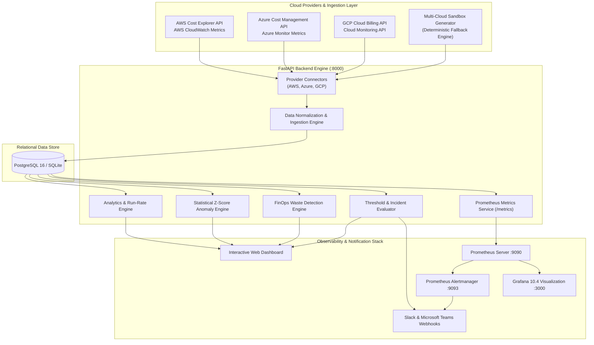
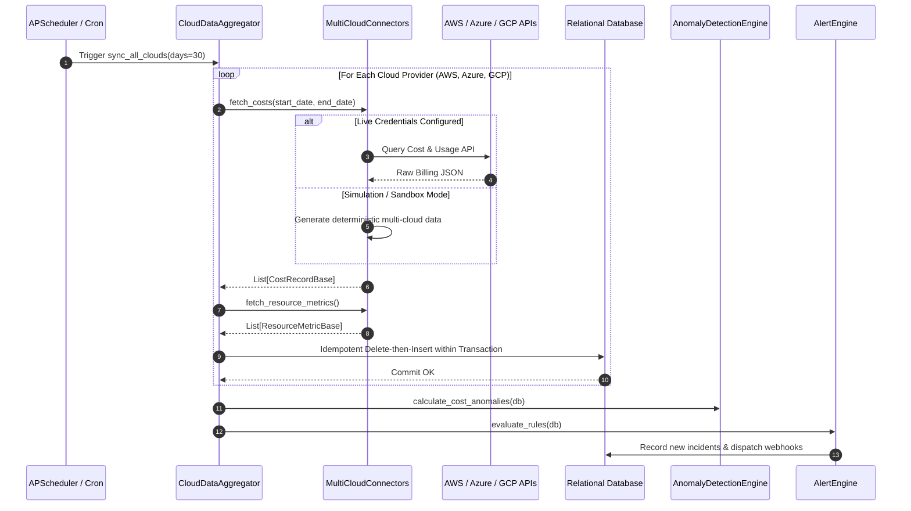
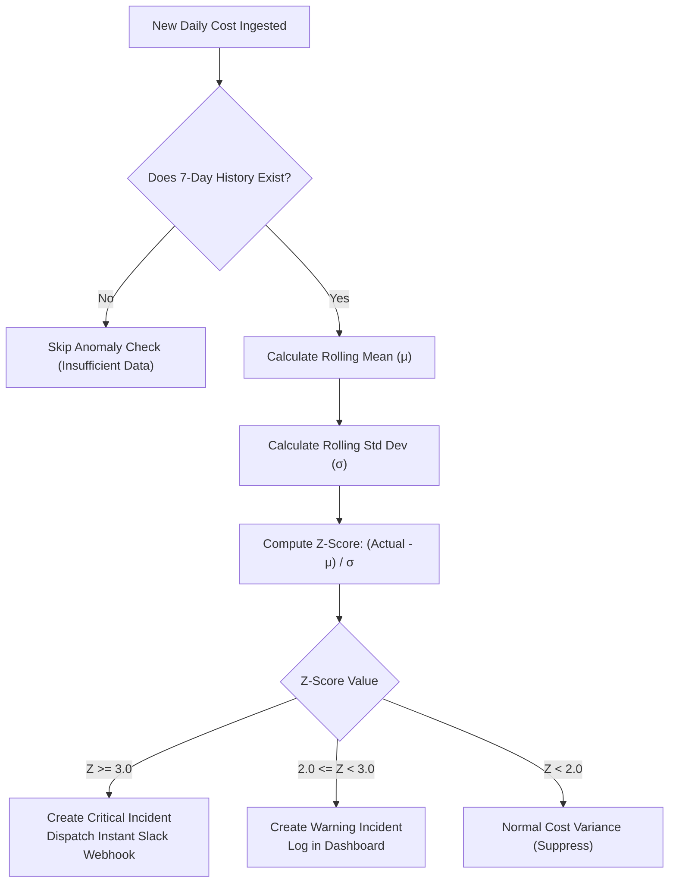
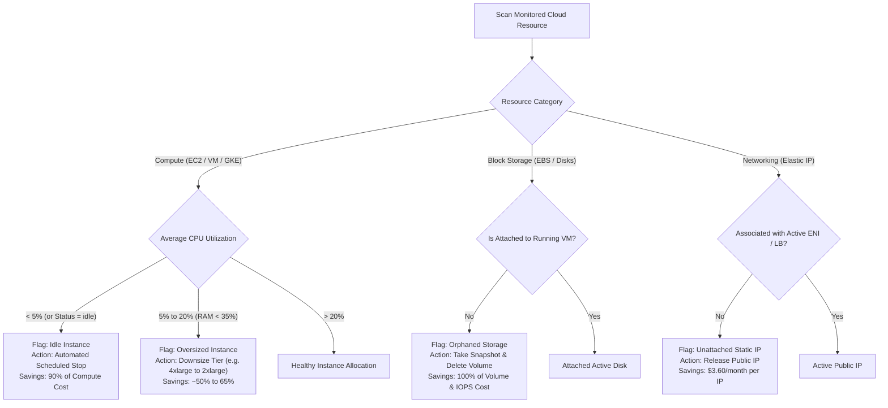
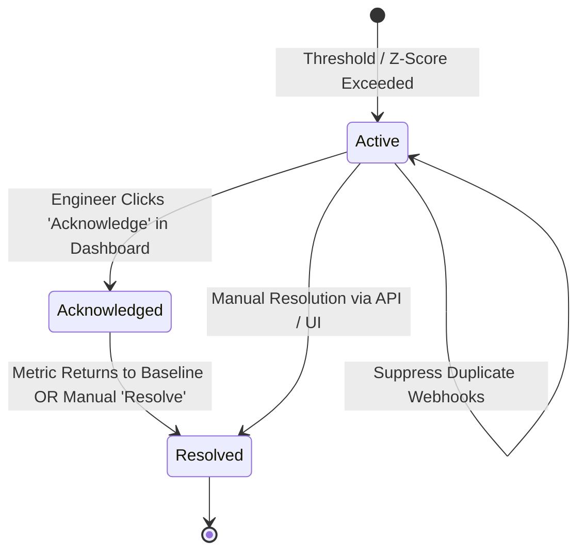

# Technical Architecture & System Design Document

**Project**: DevOps Multi-Cloud Dashboard for Resource & Cost Monitoring  
**Target Architecture**: Decoupled, Microservice-Ready Observability & FinOps Platform  

---

## 1. Executive Architectural Overview

The **DevOps Multi-Cloud Cost & Resource Monitoring Platform** provides centralized visibility, proactive anomaly alerting, and automated waste reclamation across heterogeneous cloud environments (**Amazon Web Services**, **Microsoft Azure**, and **Google Cloud Platform**).

---

## 2. Ingestion & Data Normalization Architecture

Disparate cloud providers present cost and telemetry metrics in fundamentally divergent structures:
- **AWS**: Uses `UnblendedCost`, `BlendedCost`, or `AmortizedCost` with dimensions (`SERVICE`, `LINKED_ACCOUNT`, `TAG`).
- **Azure**: Uses `PreTaxCost` query payloads grouped by `Dimension: ServiceName`.
- **GCP**: Exposes SKU-level billing records, usage in milli-cores or gibibyte-months, and BigQuery billing exports.

### Ingestion Sequence Diagram

---

## 3. Database Schema & Entity-Relationship Diagram (ERD)

The database schema is fully normalized to 3NF and supported across both **SQLite** (local development) and **PostgreSQL 16** (production).

```mermaid
erDiagram
    COST_RECORD {
        int id PK "Auto-incrementing primary key"
        string provider "Cloud provider: AWS, Azure, GCP (Indexed)"
        string service "Service name: EC2, S3, RDS, BigQuery, VM (Indexed)"
        string resource_id "Unique resource identifier"
        string environment "Environment: production, staging, development (Indexed)"
        string region "Cloud region: us-east-1, eastus, us-central1"
        float cost_usd "Normalized cost in USD"
        float usage_amount "Quantitative usage volume"
        string usage_unit "Usage metric: Hours, GB-Mo, Requests"
        date record_date "Date of accrual (Indexed)"
        datetime created_at "Timestamp of record ingestion"
        json tags "Key-value metadata dictionary"
    }

    RESOURCE_METRIC {
        int id PK "Primary key"
        string provider "Cloud provider (Indexed)"
        string service "Service name"
        string resource_id "Cloud resource ID (Indexed)"
        string resource_name "Human-readable resource tag/name"
        string environment "Environment tag (Indexed)"
        string region "Cloud region"
        float cpu_utilization_pct "Average CPU percentage (0.0 - 100.0)"
        float memory_utilization_pct "Average RAM percentage (0.0 - 100.0)"
        float disk_utilization_gb "Allocated block disk size"
        float network_in_mb "Inbound network transfer volume"
        float network_out_mb "Outbound network transfer volume"
        string status "Status: running, idle, stopped"
        datetime timestamp "Telemetry collection timestamp (Indexed)"
    }

    ALERT_RULE {
        int id PK "Primary key"
        string name "Descriptive rule name"
        string description "Operational context"
        string metric_type "Metric: high_cpu, high_memory, cost_daily_spike, idle_resource"
        string provider "Provider filter: ALL, AWS, Azure, GCP"
        string environment "Environment filter: ALL, production, staging, dev"
        float threshold_value "Trigger threshold"
        string operator "Comparison: gt, lt, gte, lte, eq"
        string severity "Severity: critical, warning, info"
        string notification_channel "Channel: slack, teams, webhook, email"
        string webhook_url "Optional dedicated webhook destination"
        boolean enabled "Rule active toggle"
        datetime created_at "Rule creation timestamp"
    }

    ALERT_INCIDENT {
        int id PK "Primary key"
        int rule_id FK "Foreign key referencing alert_rules.id"
        string title "Incident title"
        text message "Root cause alert description"
        string provider "Affected cloud provider"
        string service "Affected cloud service"
        string resource_id "Affected resource identifier"
        string metric_type "Triggered metric category"
        float current_value "Value at time of trigger"
        float threshold_value "Configured rule threshold"
        string severity "Severity level: critical, warning, info"
        string status "Incident status: active, acknowledged, resolved"
        datetime triggered_at "Trigger timestamp (Indexed)"
        datetime resolved_at "Resolution timestamp"
    }

    COST_RECOMMENDATION {
        int id PK "Primary key"
        string provider "Cloud provider (Indexed)"
        string service "Cloud service"
        string resource_id "Resource ID (Indexed)"
        string resource_name "Resource display name"
        string recommendation_type "Type: idle_resource, rightsizing, unattached_storage, unattached_ip"
        string title "Recommendation summary"
        text description "Detailed waste description"
        float current_monthly_cost "Current baseline monthly spend"
        float estimated_monthly_savings "Projected monthly dollar savings"
        string status "Status: pending, applied, dismissed"
        text action_plan "Actionable engineering remediation steps"
        datetime detected_at "Detection timestamp"
    }

    PROVIDER_STATUS {
        int id PK "Primary key"
        string provider UK "Provider unique name: AWS, Azure, GCP"
        string status "Status: connected, mock_mode, error, syncing"
        datetime last_sync_at "Last successful ingestion timestamp"
        string message "Diagnostic health message"
        int records_synced "Count of rows ingested in last sync"
    }

    ALERT_RULE ||--o{ ALERT_INCIDENT : "triggers"
```

---

## 4. Statistical Cost Anomaly Detection Engine

Rather than relying on static thresholds that produce high false-positive rates during expected business growth, the platform utilizes a **Rolling 7-Day Baseline Z-Score Algorithm**:

$$\mu = \frac{1}{7} \sum_{i=1}^{7} \text{Cost}_{t-i}$$

$$\sigma = \sqrt{\frac{1}{7} \sum_{i=1}^{7} (\text{Cost}_{t-i} - \mu)^2}$$

$$Z = \frac{\text{Cost}_{t} - \mu}{\sigma}$$

### Anomaly Decision Matrix
- **$Z \ge 3.0$**: **Critical Cost Spike** (Probability $< 0.13\%$ under Gaussian distribution). Dispatches immediate high-priority alert to Slack.
- **$2.0 \le Z < 3.0$**: **Warning Cost Surge** (Probability $< 2.27\%$). Logs warning incident in dashboard.
- **$Z < 2.0$**: **Normal Operational Variance**. Suppressed to prevent notification fatigue.

---

## 5. FinOps Optimization & Rightsizing Decision Tree

The FinOps engine actively inspects compute telemetry and block storage states to produce quantified monthly savings:

---

## 6. Alert Incident Lifecycle State Machine

---

## 7. Security & Network Isolation Architecture

1. **Least-Privilege Cloud IAM**: Connectors require only read-only scopes (`ce:GetCostAndUsage`, `monitoring:GetMetricData`, `CostManagement.Reader`). No destructive write permissions are required.
2. **Zero Plaintext Secrets**: Secrets are loaded exclusively from `.env` or system environment variables; never hardcoded in source code or sent to client-side browsers.
3. **Internal Microservice Networking**: Database port `5432` and Alertmanager port `9093` are isolated within the internal Docker bridge network (`devops-network`).
