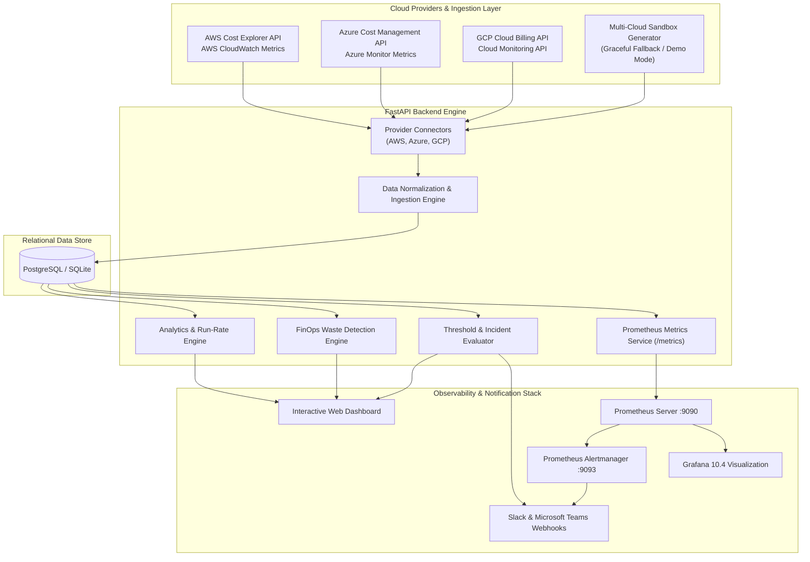
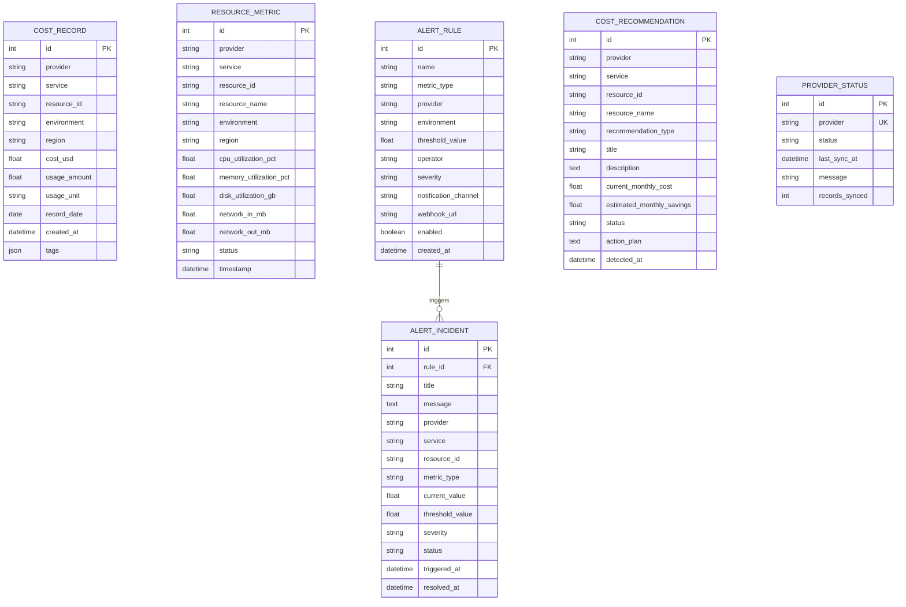
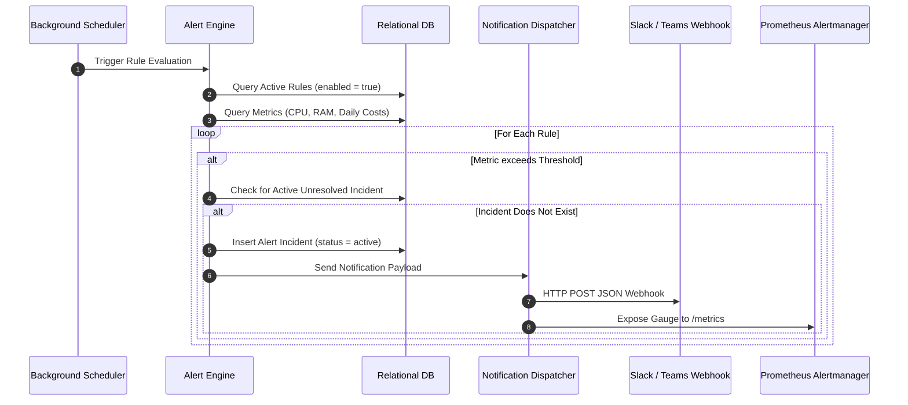

# Technical Architecture & System Design Document

## 1. Executive Architecture Summary

The **DevOps Multi-Cloud Resource & Cost Monitoring Platform** is engineered as a decoupled, microservice-ready system designed to solve the challenges of fragmented multi-cloud cost visibility, resource sprawl, and untracked infrastructure waste across **AWS**, **Microsoft Azure**, and **Google Cloud Platform (GCP)**.

---

## 2. Ingestion & Data Normalization Layer

Different cloud providers structure cost and usage data in divergent formats:
- **AWS**: Uses `UnblendedCost`, `BlendedCost`, or `AmortizedCost` grouped by `DIMENSION: SERVICE` or `TAGS`.
- **Azure**: Uses `PreTaxCost` query payloads grouped by `Dimension: ServiceName`.
- **GCP**: Exposes SKU-level billing records, usage quantities in milli-cores or gibibyte-months, and BigQuery export datasets.

### Unified Relational Schema

To provide cross-cloud queryability, the Aggregator translates all external inputs into standardized internal models:

---

## 3. FinOps Cost Optimization Engine

The optimization engine executes automated algorithms over resource metrics and cost records to surface high-impact cost savings:

### 1. Idle Resource Detection Algorithm
$$\text{Average CPU} < 5.0\% \quad \text{OR} \quad \text{Status} = \text{"idle"}$$
- Flags forgotten development/staging instances running continuously during weekends and nights.
- Calculates estimated savings: $90\%$ of total monthly compute charge upon scheduled shutdown or termination.

### 2. Compute Rightsizing Algorithm
$$5.0\% \le \text{Average CPU} \le 20.0\% \quad \text{AND} \quad \text{Memory} < 30.0\%$$
- Identifies over-provisioned instance tiers (e.g., `m5.4xlarge` provisioned for a light steady-state service).
- Recommends downsizing to the next smaller tier (e.g., `m5.xlarge`), projecting a $55\% \text{ to } 65\%$ reduction in baseline hourly costs while maintaining safety headroom.

### 3. Orphaned Storage Detection Algorithm
$$\text{Disk Capacity} > 100\text{ GB} \quad \text{AND} \quad \text{CPU Utilization} = 0.0\%$$
- Detects unattached EBS volumes, unmanaged Azure Disks, and persistent GCP disks detached from terminated VMs.
- Recommends taking a point-in-time compliance snapshot and deleting the unattached block device.

---

## 4. Alerting & Notification Pipeline

---

## 5. Security & Least Privilege Architecture

1. **Read-Only IAM Policies**: Cloud connectors operate exclusively under least-privilege read-only permissions (`ce:GetCostAndUsage`, `monitoring:GetMetricData`, `CostManagement.Reader`). No destructive write permissions are required.
2. **Zero Plaintext Tokens**: Application Default Credentials (ADC) or environmental secrets are loaded via environment variables; credentials are never committed or exposed in frontend payloads.
3. **Graceful Simulation Fallback**: If cloud credentials are not supplied, the platform automatically engages its sandboxed multi-cloud engine, ensuring full evaluation capabilities without security exposure.
