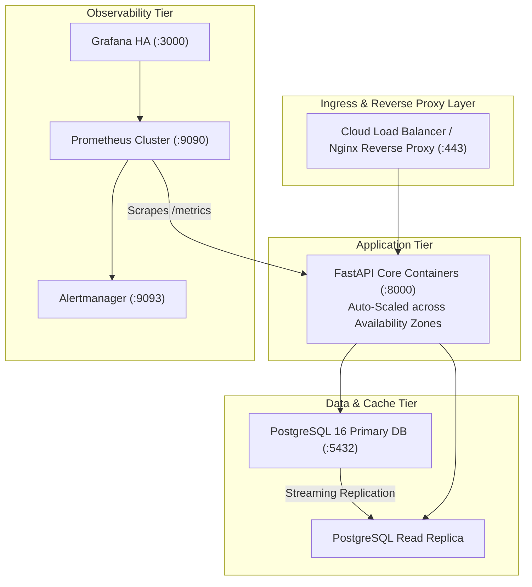

# Production Operations & Deployment Runbook

> **Service**: DevOps Multi-Cloud Cost & Resource Monitoring Platform  
> **Environment**: Production / Staging  
> **Audience**: Site Reliability Engineers (SRE), DevOps Engineers, Platform Administrators  

---

## 1. Production Architecture Overview

The platform is architected as a set of lightweight, containerized microservices communicating over a private Docker network or Kubernetes namespace:



---

## 2. Docker Compose Deployment Procedure

### Pre-Deployment Checklist
- [ ] Docker Engine 24.0+ and Docker Compose v2.20+ installed.
- [ ] Ensure ports `8000`, `5432`, `9090`, `9093`, and `3000` are permitted in security groups.
- [ ] Copy `.env.example` to `.env` and configure real cloud credentials or keep `MOCK_CLOUD_MODE=true` for sandbox.

### Execution Steps
```bash
# 1. Clone repository
git clone https://github.com/kautikbhardwaj/Kautik_batch16_CapstoneProject.git
cd Kautik_batch16_CapstoneProject

# 2. Build images and start all 5 microservices in detached mode
docker compose up --build -d

# 3. Verify container health status
docker compose ps
```

### Expected Service Map
```text
NAME                    IMAGE                  COMMAND                  SERVICE       STATUS
devops-cost-app         devops-cost-app        "uvicorn backend.app…"   app           running (healthy)
devops-cost-postgres    postgres:16-alpine     "docker-entrypoint.s…"   db            running (healthy)
devops-prometheus       prom/prometheus:v2.50  "/bin/prometheus --c…"   prometheus    running
devops-alertmanager     prom/alertmanager:v0.2 "/bin/alertmanager -…"   alertmanager  running
devops-grafana          grafana/grafana:10.4   "/run.sh"                grafana       running
```

---

## 3. Kubernetes Deployment Manifest (EKS / AKS / GKE)

For enterprise orchestration, deploy using standard Kubernetes manifests:

```yaml
apiVersion: apps/v1
kind: Deployment
metadata:
  name: devops-cost-dashboard
  namespace: monitoring
  labels:
    app.kubernetes.io/name: devops-cost-dashboard
spec:
  replicas: 2
  selector:
    matchLabels:
      app: devops-cost-dashboard
  template:
    metadata:
      labels:
        app: devops-cost-dashboard
    spec:
      containers:
        - name: dashboard
          image: ghcr.io/kautikbhardwaj/devops-cost-dashboard:latest
          ports:
            - containerPort: 8000
          envFrom:
            - secretRef:
                name: cloud-cost-credentials
          livenessProbe:
            httpGet:
              path: /healthz
              port: 8000
            initialDelaySeconds: 15
            periodSeconds: 20
          readinessProbe:
            httpGet:
              path: /healthz
              port: 8000
            initialDelaySeconds: 5
            periodSeconds: 10
          resources:
            requests:
              cpu: "250m"
              memory: "512Mi"
            limits:
              cpu: "1000m"
              memory: "1Gi"
---
apiVersion: v1
kind: Service
metadata:
  name: devops-cost-service
  namespace: monitoring
spec:
  type: ClusterIP
  ports:
    - port: 80
      targetPort: 8000
      name: http
  selector:
    app: devops-cost-dashboard
```

---

## 4. Disaster Recovery & Database Backup Procedures

### Automated Daily PostgreSQL Backup
```bash
# Create timestamped database backup
docker compose exec -t db pg_dump -U postgres devops_cost_db > backup_$(date +%Y%m%d_%H%M%S).sql

# Compress and archive to S3 / Cloud Storage
gzip backup_*.sql
aws s3 cp backup_*.sql.gz s3://my-finops-backups/postgres/
```

### Point-in-Time Database Restoration
```bash
# Uncompress backup
gunzip backup_20261018_230000.sql.gz

# Restore into PostgreSQL container
docker compose exec -T db psql -U postgres devops_cost_db < backup_20261018_230000.sql
```

---

## 5. Incident Response Troubleshooting Playbook

| Symptom | Probable Cause | Verification & Remediation Procedure |
| :--- | :--- | :--- |
| **`ConnectionRefusedError: [WinError 10061]`** | FastAPI backend container is stopped or port `8000` is bound by another process. | 1. Run `netstat -ano \| findstr :8000` to inspect listening ports.<br/>2. Verify container logs: `docker compose logs app`. |
| **Cloud Sync Timeout or 403 Forbidden** | Expired AWS STS session token, invalid Azure Service Principal Secret, or missing GCP IAM permissions. | 1. Check connector health: `python cli.py status`.<br/>2. Ensure AWS IAM role has `ce:GetCostAndUsage` policy attached. |
| **Prometheus Scrape Target `DOWN`** | Prometheus cannot resolve container hostname `app:8000` or network bridge disconnected. | 1. Verify `docker network inspect devops-cost-dashboard_devops-network`.<br/>2. Curl healthcheck from Prometheus container: `docker compose exec prometheus wget -qO- http://app:8000/healthz`. |
| **High False-Positive Alert Incidents** | Threshold is set too low for dynamic auto-scaling workloads. | 1. Open dashboard, navigate to **Alerts & Thresholds**.<br/>2. Adjust threshold value or switch from static thresholds to statistical **Z-Score** anomaly detection. |
