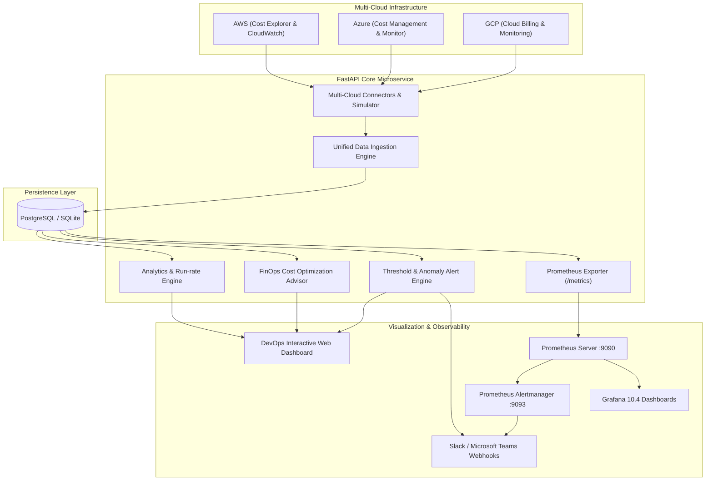

# DevOps Multi-Cloud Dashboard for Resource & Cost Monitoring

[](https://www.python.org/downloads/)
[](https://fastapi.tiangolo.com/)
[](https://react.dev/)
[](https://www.docker.com/)
[](https://prometheus.io/)
[](https://grafana.com/)
[]()

> A centralized, enterprise-grade multi-cloud FinOps & DevOps monitoring platform aggregating resource utilization and cost analytics across **AWS, Microsoft Azure, and Google Cloud Platform (GCP)**.

---

## 📌 Problem Statement

Modern DevOps teams frequently struggle to monitor compute resource usage and track infrastructure costs across heterogeneous cloud providers (AWS, Azure, and GCP). Without unified visibility into resource allocation and spend:
1. **Unchecked Cloud Waste**: Idle virtual machines and orphaned storage disks run indefinitely, accumulating unnecessary charges.
2. **Billing Blindspots**: Disparate cloud consoles make cross-cloud cost attribution, MoM trend analysis, and budget forecasting extremely tedious.
3. **Reactive Firefighting**: Cost spikes (e.g. unindexed database queries or runaway ETL jobs) are detected weeks later on the monthly invoice rather than in real time.

This project delivers a **unified DevOps Resource and Cost Dashboard** that normalizes multi-cloud telemetry, provides real-time and historical trend analytics, executes algorithmic FinOps waste detection, and triggers automated alerts to Slack, Microsoft Teams, and Prometheus Alertmanager.

---

## 🌟 Key Features

| Capability | Description |
| :--- | :--- |
| **Multi-Cloud Ingestion** | Connectors for **AWS Cost Explorer / CloudWatch**, **Azure Cost Management / Monitor**, and **GCP Cloud Billing / Cloud Monitoring** with a unified relational schema. |
| **Real-Time & Historical Analytics** | 7-day, 30-day, and 60-day interactive time-series visualizations, MoM growth calculations, linear end-of-month spend forecasting, and vendor distribution charts. |
| **Algorithmic FinOps Advisor** | Automated waste detection for **idle compute instances** (<5% CPU), **oversized resources** (rightsizing opportunities), and **unattached storage volumes** (orphaned disks) with quantified monthly dollar savings. |
| **Dynamic Alerting Engine** | Threshold-based rule evaluation with real-time incident logging, severity tagging (Critical, Warning, Info), and webhook dispatching for **Slack** and **Microsoft Teams**. |
| **Prometheus & Grafana Ready** | Native `/metrics` exporter exposing live Prometheus gauges for total spend, CPU/memory percentages, and active alerts, accompanied by pre-provisioned Grafana dashboards. |
| **Zero-Friction Sandbox Mode** | Built-in high-fidelity multi-cloud simulation mode allowing instant demonstration and testing with zero external API keys required. |

---

## 🏛️ System Architecture



---

## 🚀 Quick Start (Local Development)

### Prerequisites
- Python 3.11+
- Git

### 1. Clone & Setup Repository
```bash
git clone https://github.com/your-org/devops-cost-dashboard.git
cd devops-cost-dashboard
```

### 2. Install Python Dependencies
```bash
pip install -r backend/requirements.txt
```

### 3. Configure Environment Variables
Copy `.env.example` to `.env`:
```bash
cp .env.example .env
```
*(By default, `MOCK_CLOUD_MODE=true` is enabled, allowing instant out-of-the-box demonstration without entering cloud API credentials).*

### 4. Run Application
```bash
python run.py
```

### 5. Access Services
- 🌐 **Interactive Dashboard UI**: [http://localhost:8000](http://localhost:8000)
- 📚 **Swagger OpenAPI Docs**: [http://localhost:8000/docs](http://localhost:8000/docs)
- 📊 **Prometheus Metrics**: [http://localhost:8000/metrics](http://localhost:8000/metrics)
- 💓 **Healthcheck Endpoint**: [http://localhost:8000/healthz](http://localhost:8000/healthz)

---

## 🐳 Docker & Microservice Deployment

To spin up the complete production microservice stack (**FastAPI, PostgreSQL 16, Prometheus, Alertmanager, and Grafana**):

```bash
docker compose up --build -d
```

### Service Map
| Container | Port | Description |
| :--- | :--- | :--- |
| `devops-cost-app` | `8000` | FastAPI application serving REST API & Web Dashboard |
| `devops-cost-postgres` | `5432` | Relational database holding historical costs & telemetry |
| `devops-prometheus` | `9090` | Time-series scraper scraping `/metrics` every 15s |
| `devops-alertmanager` | `9093` | Alert routing and dispatching service |
| `devops-grafana` | `3000` | Visual analytics (User: `admin` / Password: `admin`) |

---

## 🧪 Running Automated Tests

Run the Pytest suite to execute unit and integration tests across cloud connectors, data aggregation, FinOps optimization, alerting rules, and API endpoints:

```bash
python -m pytest backend/tests/ -v
```

Output:
```text
backend/tests/test_api.py::test_healthcheck PASSED
backend/tests/test_api.py::test_prometheus_metrics PASSED
backend/tests/test_api.py::test_dashboard_overview PASSED
backend/tests/test_api.py::test_cost_records_api PASSED
backend/tests/test_api.py::test_resources_api PASSED
backend/tests/test_api.py::test_alerts_api PASSED
backend/tests/test_api.py::test_recommendations_api PASSED
backend/tests/test_api.py::test_sync_status_api PASSED
backend/tests/test_connectors.py::test_aws_connector PASSED
backend/tests/test_connectors.py::test_azure_connector PASSED
backend/tests/test_connectors.py::test_gcp_connector PASSED
backend/tests/test_optimizer.py::test_cost_optimization_engine PASSED

======================= 12 passed in 1.93s =======================
```

---

## 📂 Project Directory Structure

```text
devops-cost-dashboard/
├── backend/
│   ├── app/
│   │   ├── api/                   # REST API routes (dashboard, costs, resources, alerts, sync)
│   │   ├── metrics/               # Prometheus /metrics exporter
│   │   ├── models/                # SQLAlchemy ORM schemas
│   │   ├── schemas/               # Pydantic v2 validation models
│   │   ├── services/
│   │   │   ├── cloud/             # AWS, Azure, GCP connectors & sandbox simulator
│   │   │   ├── aggregator.py      # Multi-cloud ingestion & normalization engine
│   │   │   ├── analytics.py       # MoM, run-rate, trend analytics
│   │   │   ├── optimizer.py       # FinOps algorithmic waste detection
│   │   │   ├── alerting.py        # Dynamic threshold rules evaluation
│   │   │   └── notifier.py        # Slack & Teams webhook dispatcher
│   │   ├── static/                # Single-page interactive frontend
│   │   ├── config.py              # Pydantic BaseSettings
│   │   ├── database.py            # SQLite / PostgreSQL engine & session
│   │   └── main.py                # FastAPI entrypoint, lifespan & scheduler
│   ├── tests/                     # 12 Pytest test suites
│   ├── requirements.txt           # Python dependencies
│   └── Dockerfile                 # Multi-stage production container
├── frontend/                      # React 18 + Vite source codebase
│   ├── src/                       # Components, Pages, and API services
│   ├── package.json
│   └── vite.config.js
├── monitoring/
│   ├── prometheus/                # prometheus.yml & alert_rules.yml
│   ├── alertmanager/              # alertmanager.yml
│   └── grafana/                   # Auto-provisioned datasources and dashboard JSON
├── docker-compose.yml             # Full-stack microservices orchestration
├── run.py                         # Single-command local launcher
├── ARCHITECTURE.md                # System design & data models
├── SPRINT_REPORT.md               # Sprint 1 to 6 breakdown (120 hours)
├── COST_OPTIMIZATION_GUIDE.md     # FinOps strategies & rightsizing matrices
└── VIVA_PRESENTATION_PREP.md      # Comprehensive Viva defense & demo script
```

---

## 🏆 Sprint Deliverables Mapping

| Sprint | Goal | Key Deliverables | Status |
| :---: | :--- | :--- | :---: |
| **Sprint 1** | Project Setup & Cloud Integration | Multi-cloud connectors for AWS, Azure, GCP, configuration management, credential validation. | ✅ Complete |
| **Sprint 2** | Data Aggregation & Database Schema | Unified relational data model, ingestion engine, SQLite/PostgreSQL storage, scheduled sync. | ✅ Complete |
| **Sprint 3** | Real-Time Dashboard Development | Interactive executive dashboard, KPI stat cards, multi-cloud filters (vendor, environment). | ✅ Complete |
| **Sprint 4** | Historical Analytics & Trends | 30/60-day cost trend line charts, MoM velocity, run-rate forecast, top service breakdowns. | ✅ Complete |
| **Sprint 5** | Alerting & Notifications | Dynamic threshold rule engine, incident logging, Slack/Teams dispatch, Prometheus exporter. | ✅ Complete |
| **Sprint 6** | Testing, Docker & Documentation | 12 Pytest test suites, Dockerfile, docker-compose.yml, Grafana dashboard, comprehensive docs. | ✅ Complete |

---

## 📄 License
This project is licensed under the MIT License.
