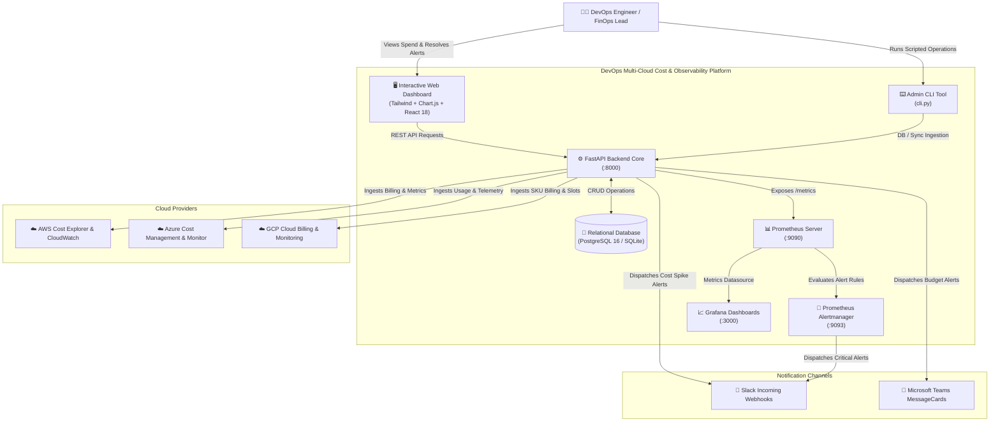
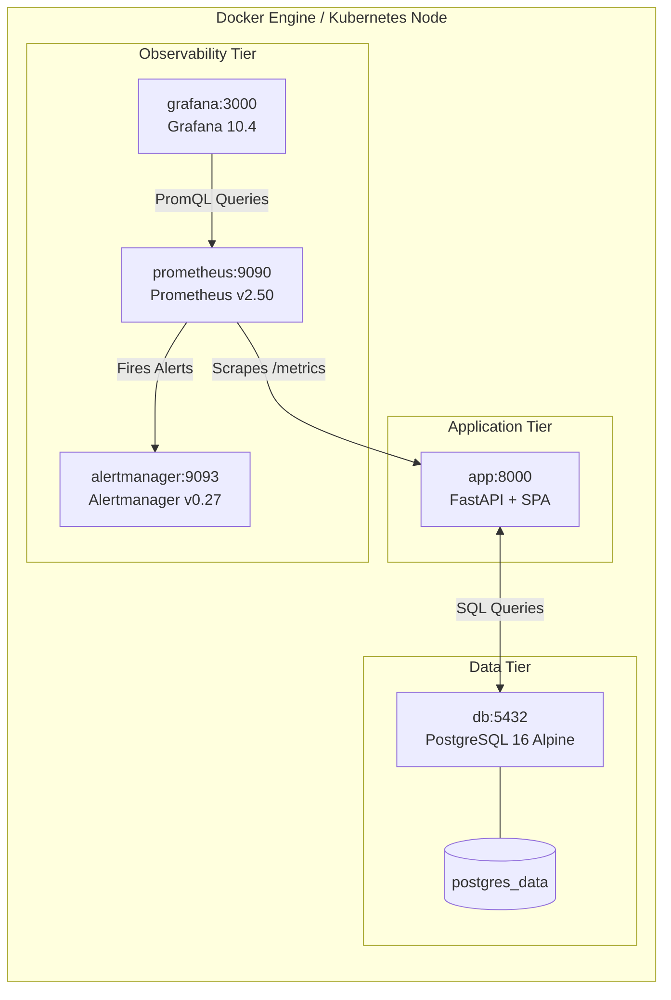

# DevOps Multi-Cloud Dashboard for Resource & Cost Monitoring

[](https://www.python.org/downloads/)
[](https://fastapi.tiangolo.com/)
[](https://react.dev/)
[](https://www.docker.com/)
[](https://prometheus.io/)
[](https://grafana.com/)
[]()
[](LICENSE)

> **Enterprise-grade multi-cloud FinOps & DevOps observability platform** aggregating real-time resource utilization and cost analytics across **Amazon Web Services (AWS)**, **Microsoft Azure**, and **Google Cloud Platform (GCP)**.

---

## 📌 Problem Statement

DevOps and Cloud Engineering teams face critical challenges managing multi-cloud infrastructure:
1. **Cloud Cost Blindspots**: Disparate cloud billing consoles (AWS Cost Explorer, Azure Cost Management, GCP Cloud Billing) prevent a unified view of organizational spend.
2. **Unchecked Cloud Waste**: Forgotten development VMs, oversized production instances, and unattached storage disks accrue monthly charges indefinitely.
3. **Delayed Anomaly Detection**: Sudden spend surges caused by unindexed queries or runaway batch pipelines are often only caught weeks later on monthly invoices.

This project delivers a **centralized, containerized DevOps dashboard** that standardizes multi-cloud telemetry, computes rolling baseline cost anomalies (Z-Score), automates FinOps waste detection, and dispatches real-time alerts to Slack, Microsoft Teams, and Prometheus Alertmanager.

---

## 🏛️ System Architecture Diagrams

### 1. High-Level C4 Context Diagram



---

### 2. Microservice Deployment & Container Topology



---

## 🌟 Key Functional Modules

| Module | Core Features | Source Location |
| :--- | :--- | :--- |
| **Multi-Cloud Connectors** | Unified adapter pattern connecting to AWS Cost Explorer, Azure Cost Management, and GCP Cloud Billing with high-fidelity offline simulation fallback. | [`backend/app/services/cloud/`](backend/app/services/cloud/) |
| **Data Ingestion Engine** | Normalizes disparate cloud pricing models into a unified schema; prevents duplicates via idempotent transactions. | [`backend/app/services/aggregator.py`](backend/app/services/aggregator.py) |
| **Statistical Anomaly Detector** | Rolling 7-day standard deviation and Z-score calculation to detect abnormal spend spikes with root-cause hypotheses. | [`backend/app/services/anomaly.py`](backend/app/services/anomaly.py) |
| **FinOps Optimization Advisor** | Automated detection of idle compute (<5% CPU), oversized instances (rightsizing), unattached disks, and unallocated Elastic IPs. | [`backend/app/services/optimizer.py`](backend/app/services/optimizer.py) |
| **Alert Rules & Dispatcher** | Dynamic threshold rule evaluation, incident lifecycle tracking, and formatted Slack/Teams webhook payloads. | [`backend/app/services/alerting.py`](backend/app/services/alerting.py) |
| **Administrative CLI** | Scriptable command-line tool for cron jobs, CI/CD pipelines, CSV exports, and automated sync. | [`cli.py`](cli.py) |
| **Prometheus Exporter** | Exposes native metrics at `/metrics` including spend gauges, CPU/memory telemetry, and active alert counts. | [`backend/app/metrics/prometheus.py`](backend/app/metrics/prometheus.py) |

---

## 🚀 Quick Start (Local Development)

### Prerequisites
- Python 3.11+
- Git

### 1. Clone & Set Up Environment
```bash
git clone https://github.com/kautikbhardwaj/Kautik_batch16_CapstoneProject.git
cd Kautik_batch16_CapstoneProject
```

### 2. Install Dependencies
```bash
pip install -r backend/requirements.txt
```

### 3. Launch Application
```bash
python run.py
```

### 4. Access Services
- 🌐 **Interactive Dashboard**: [http://localhost:8000](http://localhost:8000)
- 📚 **Interactive Swagger API**: [http://localhost:8000/docs](http://localhost:8000/docs)
- 📊 **Prometheus Exporter**: [http://localhost:8000/metrics](http://localhost:8000/metrics)
- 💓 **Healthcheck**: [http://localhost:8000/healthz](http://localhost:8000/healthz)

---

## ⌨️ Administrative CLI (`cli.py`) Usage

For automated operations, cron jobs, and CI/CD pipelines:

```bash
# Display cloud provider connectivity and health status
python cli.py status

# Run statistical Z-Score cost anomaly detection
python cli.py anomalies --threshold 2.0 --days 30

# Run FinOps optimization waste analysis
python cli.py optimize

# Export standardized multi-cloud cost ledger to CSV
python cli.py export-csv --output monthly_cloud_ledger.csv

# Trigger multi-cloud synchronization on-demand
python cli.py sync --days 30

# Dispatch a test webhook alert to Slack or Teams
python cli.py test-alert --channel slack
```

---

## 🐳 Docker Compose Deployment

To launch the full microservices stack (**FastAPI, PostgreSQL 16, Prometheus, Alertmanager, Grafana**):

```bash
docker compose up --build -d
```

### Service Map
| Container | Port | Description |
| :--- | :--- | :--- |
| `devops-cost-app` | `8000` | FastAPI backend & single-page dashboard UI |
| `devops-cost-postgres` | `5432` | PostgreSQL relational database |
| `devops-prometheus` | `9090` | Prometheus scraper & time-series storage |
| `devops-alertmanager` | `9093` | Alertmanager routing & notification engine |
| `devops-grafana` | `3000` | Grafana visual analytics (User: `admin` / Pass: `admin`) |

---

## 🧪 Automated Testing Suite

The repository contains 13 unit and integration test suites covering every layer of the architecture:

```bash
python -m pytest backend/tests/ -v
```

```text
backend/tests/test_anomaly.py::test_anomaly_detection_engine PASSED      [  7%]
backend/tests/test_api.py::test_healthcheck PASSED                       [ 15%]
backend/tests/test_api.py::test_prometheus_metrics PASSED                [ 23%]
backend/tests/test_api.py::test_dashboard_overview PASSED                [ 30%]
backend/tests/test_api.py::test_cost_records_api PASSED                  [ 38%]
backend/tests/test_api.py::test_resources_api PASSED                     [ 46%]
backend/tests/test_api.py::test_alerts_api PASSED                        [ 53%]
backend/tests/test_api.py::test_recommendations_api PASSED               [ 61%]
backend/tests/test_api.py::test_sync_status_api PASSED                   [ 69%]
backend/tests/test_connectors.py::test_aws_connector PASSED              [ 76%]
backend/tests/test_connectors.py::test_azure_connector PASSED            [ 84%]
backend/tests/test_connectors.py::test_gcp_connector PASSED              [ 92%]
backend/tests/test_optimizer.py::test_cost_optimization_engine PASSED    [100%]

============================= 13 passed in 2.23s ==============================
```

---

## 📂 Repository Directory Map

```text
.
├── backend/
│   ├── app/
│   │   ├── api/                   # REST API routes (dashboard, costs, resources, alerts, anomalies, sync)
│   │   ├── metrics/               # Prometheus /metrics exporter
│   │   ├── models/                # SQLAlchemy relational ORM models
│   │   ├── schemas/               # Pydantic v2 schemas
│   │   ├── services/
│   │   │   ├── cloud/             # AWS, Azure, GCP connectors & sandbox simulator
│   │   │   ├── aggregator.py      # Multi-cloud ingestion & normalization engine
│   │   │   ├── analytics.py       # MoM, run-rate, and trend analytics
│   │   │   ├── anomaly.py         # Statistical Z-Score anomaly detector
│   │   │   ├── optimizer.py       # FinOps waste detection engine
│   │   │   ├── alerting.py        # Dynamic threshold rules evaluation
│   │   │   └── notifier.py        # Slack & Teams webhook dispatcher
│   │   ├── static/                # Single-page interactive web UI
│   │   ├── config.py              # Environment configuration (.env)
│   │   ├── database.py            # SQLite / PostgreSQL engine & session
│   │   └── main.py                # FastAPI entrypoint, lifespan & scheduler
│   ├── tests/                     # 13 Pytest test suites
│   ├── requirements.txt           # Python dependencies
│   └── Dockerfile                 # Multi-stage production container
├── frontend/                      # React 18 + Vite source codebase
│   ├── src/                       # Components, Pages, and API services
│   ├── package.json
│   └── vite.config.js
├── monitoring/
│   ├── prometheus/                # prometheus.yml & alert_rules.yml
│   ├── alertmanager/              # alertmanager.yml
│   └── grafana/                   # Auto-provisioned datasources and dashboard JSON
├── cli.py                         # Administrative CLI utility
├── docker-compose.yml             # Full-stack microservices orchestration
├── run.py                         # Single-command local launcher
├── ARCHITECTURE.md                # System design, unified schemas & security
├── SPRINT_REPORT.md               # Sprints 1 to 6 breakdown (120 hours logged)
├── COST_OPTIMIZATION_GUIDE.md     # FinOps strategies & rightsizing matrices
├── DEPLOYMENT_RUNBOOK.md          # Production deployment & operations runbook
└── VIVA_PRESENTATION_PREP.md      # Viva defense questions & 5-minute demo script
```

---

## 🏆 Sprint Deliverables Mapping (120 Hours)

| Sprint | Objective | Deliverables | Status |
| :---: | :--- | :--- | :---: |
| **Sprint 1** | Project Setup & Cloud Integration | Multi-cloud connectors for AWS, Azure, GCP, configuration loader, credential validation. | ✅ Complete |
| **Sprint 2** | Data Aggregation & Database Schema | Unified relational schema, SQLite & PostgreSQL engine, ingestion pipeline, automated scheduler. | ✅ Complete |
| **Sprint 3** | Real-Time Dashboard Development | Interactive dashboard UI, executive KPI cards, multi-cloud filters (vendor, environment). | ✅ Complete |
| **Sprint 4** | Historical Analysis & Trends | Multi-cloud daily trend line charts, MoM velocity, linear forecast, top services bar chart. | ✅ Complete |
| **Sprint 5** | Alerting & Notifications | Dynamic threshold rule engine, incident tracking, Slack/Teams webhooks, Prometheus exporter. | ✅ Complete |
| **Sprint 6** | Testing, Containerization & Docs | 13 Pytest suites, Dockerfile, docker-compose.yml, Grafana dashboard, comprehensive documentation. | ✅ Complete |

---

## 📄 License
This project is licensed under the MIT License.
