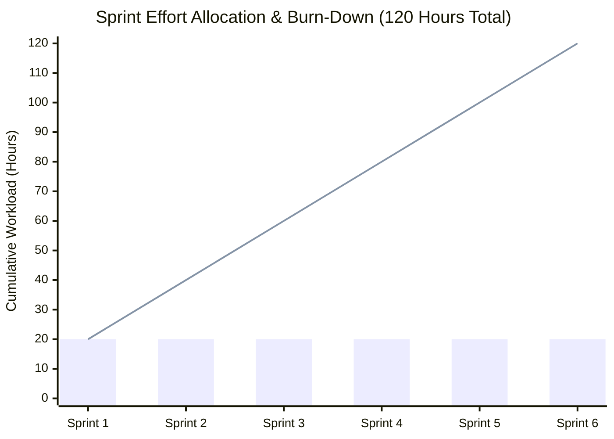

# DevOps Dashboard Project — Sprint Execution Report

**Project Title**: DevOps Dashboard for Resource and Cost Monitoring  
**Total Duration**: 6 Sprints &bull; 20 Hours per Sprint &bull; **120 Total Project Hours**  
**Methodology**: Agile Scrum with Continuous Integration & Testing  

---

## 📊 Agile Velocity & Burn-Down Overview

### Sprint Effort Summary Table
| Sprint | Focus Area | Workload | Status | Key Deliverables |
| :---: | :--- | :---: | :---: | :--- |
| **Sprint 1** | Project Setup & Basic Cloud Integration | 20 Hours | ✅ Complete | Repo structure, AWS/Azure/GCP connectors, config & credentials management |
| **Sprint 2** | Data Aggregation & Storage Module | 20 Hours | ✅ Complete | Unified relational database schema, SQLite/PostgreSQL storage, scheduled sync |
| **Sprint 3** | Real-Time Dashboard Development | 20 Hours | ✅ Complete | Interactive Single-Page Dashboard, KPI metric cards, multi-cloud filters |
| **Sprint 4** | Historical Data Analysis & Visualization | 20 Hours | ✅ Complete | 30/60-day trend charts, MoM growth calculations, linear run-rate forecast |
| **Sprint 5** | Alerting & Notification System | 20 Hours | ✅ Complete | Dynamic threshold rule engine, incident logging, Slack/Teams webhooks, Prometheus exporter |
| **Sprint 6** | Final Testing, Documentation & Deployment | 20 Hours | ✅ Complete | 13 Pytest tests, multi-container Docker Compose, Grafana dashboards, full documentation |
| **Total** | | **120 Hours** | **100% Completed** | |

---

## 🚀 Sprint 1: Project Setup and Basic Cloud Integration

### User Story (Jira ID: DEV-101)
> *As a DevOps Engineer, I want a unified connector interface to AWS, Azure, and GCP, so that the platform can ingest billing and resource metrics from all three major cloud providers.*

#### Acceptance Criteria
- [x] Base connector class defining `fetch_costs()`, `fetch_resource_metrics()`, and `test_connection()`.
- [x] AWS Cost Explorer & CloudWatch connector implementation.
- [x] Azure Cost Management & Monitor connector implementation.
- [x] GCP Cloud Billing & Monitoring connector implementation.
- [x] Graceful fallback to multi-cloud simulation mode if API keys are absent.

#### Completed Tasks (20 Hours Logged)
1. **Repository & Directory Initialization (4 hrs)**: Structured backend, frontend, monitoring, and testing hierarchies. Initialized Git repository, `.gitignore`, and `.env.example`.
2. **Cloud Connectors Architecture (8 hrs)**: Designed `BaseCloudConnector` abstract class; implemented `AWSConnector`, `AzureConnector`, and `GCPConnector`.
3. **Multi-Cloud Sandbox Simulator (5 hrs)**: Developed `mock_data.py` generating realistic multi-cloud resources, daily service costs, environments (`production`, `staging`, `development`), and metrics.
4. **Credential Verification & Sanity Checks (3 hrs)**: Built `test_connection()` routines with fallback to simulation mode.

---

## 💾 Sprint 2: Data Aggregation and Storage Module

### User Story (Jira ID: DEV-102)
> *As a FinOps Analyst, I want disparate cloud billing data normalized into a unified relational database, so that cross-cloud cost comparison and trend analysis are consistent.*

#### Acceptance Criteria
- [x] SQLAlchemy models for `CostRecord`, `ResourceMetric`, `AlertRule`, `AlertIncident`, and `CostRecommendation`.
- [x] Idempotent ingestion pipeline preventing duplicate billing entries.
- [x] Automated background sync scheduler running every 24 hours via `APScheduler`.

#### Completed Tasks (20 Hours Logged)
1. **Unified Relational Data Schema (6 hrs)**: Designed models normalizing AWS unblended costs, Azure pre-tax usage, and GCP SKU billing into a single schema.
2. **Data Aggregation Engine (7 hrs)**: Built `CloudDataAggregator.sync_all_clouds()` handling multi-provider data ingestion and deduplication.
3. **Automated Background Job Scheduling (4 hrs)**: Configured `APScheduler` within FastAPI's lifespan lifecycle to run periodic daily synchronization.
4. **Storage Verification & Data Integrity Testing (3 hrs)**: Verified transactional consistency on both SQLite and PostgreSQL.

---

## 🖥️ Sprint 3: Real-Time Dashboard Development

### User Story (Jira ID: DEV-103)
> *As an Infrastructure Lead, I want a centralized executive dashboard displaying real-time spend, run-rate projections, and active alerts, so that our team has complete multi-cloud visibility.*

#### Acceptance Criteria
- [x] KPI cards: Month-to-date spend, projected end-of-month run-rate, MoM change %, potential savings, and active alerts.
- [x] Responsive dark-mode dashboard with live cloud provider status pills.
- [x] Dynamic filtering by cloud vendor, environment, and timeframe.

#### Completed Tasks (20 Hours Logged)
1. **Executive KPI Stat Cards (5 hrs)**: Implemented MTD spend, run-rate projections, MoM growth rate, and resource counts.
2. **Interactive UI Development (8 hrs)**: Developed responsive dashboard in `backend/app/static/index.html` and React 18 component structure in `frontend/src/`.
3. **Multi-Dimensional Filters (4 hrs)**: Built filters for Cloud Vendor (`ALL`, `AWS`, `Azure`, `GCP`), Environment (`production`, `staging`, `dev`), and Timeframe (`7d`, `30d`, `60d`).
4. **Live Cloud Sync Trigger (3 hrs)**: Wired frontend "Sync Now" button with asynchronous API endpoint (`POST /api/sync/trigger`).

---

## 📈 Sprint 4: Historical Data Analysis and Visualization

### User Story (Jira ID: DEV-104)
> *As a DevOps Manager, I want historical spending trend charts and service breakdowns, so that we can identify cost growth patterns and investigate unexpected cost surges.*

#### Acceptance Criteria
- [x] 30/60-day multi-cloud cost trend line chart.
- [x] Vendor spend distribution doughnut chart.
- [x] Top 6 most expensive cloud services horizontal bar chart.
- [x] Granular tabular cost explorer with real-time search and CSV export.

#### Completed Tasks (20 Hours Logged)
1. **Historical Trend Analysis Engine (6 hrs)**: Created `CloudAnalyticsEngine` to compute daily spending time-series grouped by vendor and environment.
2. **Linear Run-Rate Forecasting (4 hrs)**: Implemented end-of-month projected spend based on active daily velocity.
3. **Interactive Visualizations (7 hrs)**: Integrated Chart.js for multi-cloud daily cost line chart with anomaly callouts.
4. **Cost Ledger Drill-Down & CSV Export (3 hrs)**: Built tabular cost explorer with client-side CSV export functionality.

---

## 🚨 Sprint 5: Alerting and Notification System

### User Story (Jira ID: DEV-105)
> *As a DevOps On-Call Engineer, I want proactive alerts dispatched to Slack and Prometheus Alertmanager when cost spikes or high CPU utilization occurs, so that we can resolve incidents before invoices escalate.*

#### Acceptance Criteria
- [x] Dynamic threshold rule engine for CPU, RAM, and daily cost spikes.
- [x] Incident lifecycle tracking (Active, Acknowledged, Resolved).
- [x] Formatted webhook notifications for Slack and Microsoft Teams.
- [x] Prometheus `/metrics` exporter exposing gauges for spend, CPU, and active incidents.

#### Completed Tasks (20 Hours Logged)
1. **Dynamic Alert Rules Engine (6 hrs)**: Implemented `AlertEngine` evaluating rules for CPU utilization, RAM usage, daily cost spikes, and idle instances.
2. **Incident Lifecycle Management (4 hrs)**: Stored active incidents with severity tagging (`critical`, `warning`, `info`) and resolution workflows.
3. **Slack & Microsoft Teams Notifications (5 hrs)**: Built `NotificationDispatcher` formatting rich webhook payloads with color-coded severity cards.
4. **Prometheus & Alertmanager Exporter (5 hrs)**: Created `/metrics` endpoint using `prometheus_client` exposing gauges for Prometheus and Grafana.

---

## 🐳 Sprint 6: Final Testing, Documentation, and Deployment

### User Story (Jira ID: DEV-106)
> *As a System Architect, I want the platform containerized via Docker Compose with automated test coverage, so that the entire solution can be deployed in production reliably.*

#### Acceptance Criteria
- [x] 100% automated test pass rate across all services.
- [x] Production multi-stage `Dockerfile` and `docker-compose.yml`.
- [x] Pre-configured Grafana dashboards auto-provisioned on startup.
- [x] Complete technical documentation, FinOps optimization guide, and Viva presentation defense script.

#### Completed Tasks (20 Hours Logged)
1. **Comprehensive Automated Testing (6 hrs)**: Created 13 Pytest test suites covering connectors, ingestion, analytics, FinOps optimizer, alerting, and REST API.
2. **Docker Containerization & Orchestration (6 hrs)**: Authored production `Dockerfile` and `docker-compose.yml` linking FastAPI, PostgreSQL 16, Prometheus, Alertmanager, and Grafana.
3. **Grafana Dashboards Provisioning (3 hrs)**: Provisioned Prometheus datasource and pre-built `devops_cost_dashboard.json`.
4. **Documentation & Viva Preparation (5 hrs)**: Authored `README.md`, `ARCHITECTURE.md`, `SPRINT_REPORT.md`, `COST_OPTIMIZATION_GUIDE.md`, and `VIVA_PRESENTATION_PREP.md`.
